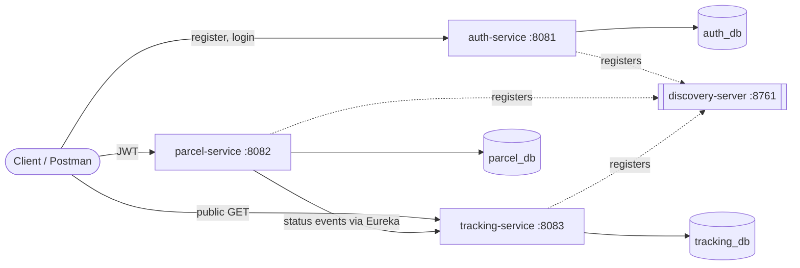

# 📦 Parcel Management System

A backend system for creating, assigning and tracking parcels, built as **Spring Boot microservices** with **JWT security**, **role-based access control** and **MySQL**. Inspired by how logistics companies (e.g. DP World) manage parcel flow from creation to delivery.

## ✨ Features
- **Authentication service** – register/login, BCrypt-hashed passwords, JWT tokens
- **Role-based access control** – `ADMIN`, `AGENT`, `CUSTOMER`, each with different permissions
- **Parcel service** – create parcels, assign to delivery agents, update delivery status with business-rule validation
- **Tracking service** – full, timestamped delivery history per parcel (public lookup by tracking number)
- **Service discovery** – services find each other through **Eureka** instead of hard-coded URLs
- **Clean REST APIs** – DTOs, bean validation, and a global exception handler giving consistent JSON errors
- **MySQL + JPA/Hibernate** – database indexes and **pagination** for efficient queries

## 🧱 Tech Stack
Java 17 · Spring Boot 3.2 · Spring Cloud (Eureka) · Spring Security · Spring Data JPA / Hibernate · MySQL 8 · JWT (jjwt) · Maven · Docker (optional, for MySQL)

## 🏗️ Architecture

Each service owns its **own database** (database-per-service pattern). The JWT is created by `auth-service` and validated independently by the other services using a shared secret.

## 🔄 How it works (flow)
1. User registers/logs in at `auth-service` → receives a **JWT** containing their email and role.
2. Customer calls `POST /api/parcels` with `Authorization: Bearer <jwt>` → parcel saved with status `CREATED`.
3. `parcel-service` calls `tracking-service` (found via Eureka) to store a tracking event.
4. Admin assigns the parcel to an agent → status `ASSIGNED`.
5. Agent updates status `IN_TRANSIT → OUT_FOR_DELIVERY → DELIVERED`; each change is recorded in tracking history.
6. Anyone can call `GET /api/tracking/{trackingNumber}` to see the history.

Status rules: only forward movement; `DELIVERED`/`CANCELLED` are final; cancel only before transit; an agent must be assigned first.

## 🔐 Roles & permissions
| Action | CUSTOMER | AGENT | ADMIN |
|---|:-:|:-:|:-:|
| Create parcel | ✅ | ❌ | ✅ |
| View parcels | own only | assigned only | all |
| Assign agent | ❌ | ❌ | ✅ |
| Update status | ❌ | assigned only | ✅ |
| Public tracking | ✅ | ✅ | ✅ (no login needed) |

## 🌐 API Reference
**auth-service (8081)**
| Method | Endpoint | Description |
|---|---|---|
| POST | `/api/auth/register` | Register (`name, email, password, role?`) |
| POST | `/api/auth/login` | Login → returns JWT |

**parcel-service (8082)** – needs `Authorization: Bearer <token>`
| Method | Endpoint | Description |
|---|---|---|
| POST | `/api/parcels` | Create parcel |
| GET | `/api/parcels?page=0&size=10&status=CREATED` | Paginated list (filtered by role) |
| GET | `/api/parcels/{trackingNumber}` | Parcel details |
| PUT | `/api/parcels/{trackingNumber}/assign` | Assign agent (ADMIN) |
| PUT | `/api/parcels/{trackingNumber}/status` | Update status (ADMIN/AGENT) |

**tracking-service (8083)**
| Method | Endpoint | Description |
|---|---|---|
| GET | `/api/tracking/{trackingNumber}` | Delivery history (public) |
| POST | `/api/tracking/events` | Manual event (ADMIN/AGENT) |

## 🚀 Run locally

### Prerequisites
1. **JDK 17** (`java -version`)
2. **Maven 3.9+** (`mvn -version`) – or just open the project in IntelliJ IDEA, which bundles Maven
3. **MySQL 8** – either installed locally (user `root`, password `root`) **or** run `docker compose up -d` using the included file
4. Git, and optionally Postman

### Steps
```bash
git clone <your-repo-url>
cd parcel-management-system

# (optional) start MySQL with Docker
docker compose up -d

# build everything once
mvn clean install -DskipTests
```
Start each service in its **own terminal**, in this order:
```bash
mvn -pl discovery-server spring-boot:run   # 1. http://localhost:8761 (Eureka dashboard)
mvn -pl auth-service spring-boot:run       # 2. :8081
mvn -pl tracking-service spring-boot:run   # 3. :8083
mvn -pl parcel-service spring-boot:run     # 4. :8082
```
Databases and tables are created automatically on first start.
Different MySQL password? `DB_PASSWORD=yourpass mvn -pl auth-service spring-boot:run` (or edit `application.yml`).

Then open http://localhost:8761 – you should see 3 registered services. Run `./test-api.sh` for an automatic end-to-end demo.

### Manual try-out (curl)
```bash
# register an admin & login
curl -X POST localhost:8081/api/auth/register -H "Content-Type: application/json" \
  -d '{"name":"Admin","email":"admin@dp.com","password":"secret123","role":"ADMIN"}'
curl -X POST localhost:8081/api/auth/login -H "Content-Type: application/json" \
  -d '{"email":"admin@dp.com","password":"secret123"}'      # copy "token"

# create a parcel
curl -X POST localhost:8082/api/parcels -H "Authorization: Bearer <TOKEN>" -H "Content-Type: application/json" \
  -d '{"senderName":"Anushka","receiverName":"Rahul","receiverAddress":"Jebel Ali, Dubai","weightKg":2.5}'
```

## 🧯 Troubleshooting
| Problem | Fix |
|---|---|
| `Access denied for user 'root'` | Wrong MySQL password → set `DB_PASSWORD` |
| `Communications link failure` | MySQL not running |
| `Port already in use` | Stop the other process or change `server.port` |
| Tracking history empty | Start `tracking-service` *before* creating parcels (wait ~30s for Eureka registration) |
| `Unsupported class file major version` | You're not on JDK 17+ |

## 🔭 Future improvements
API Gateway, Kafka for async tracking events, Docker images for every service, unit/integration tests (JUnit, Mockito, Testcontainers), Swagger/OpenAPI docs, refresh tokens, validating that an assigned agent really exists.

> Note: self-registration with a chosen role exists for demo convenience only; in production only admins would grant roles.
